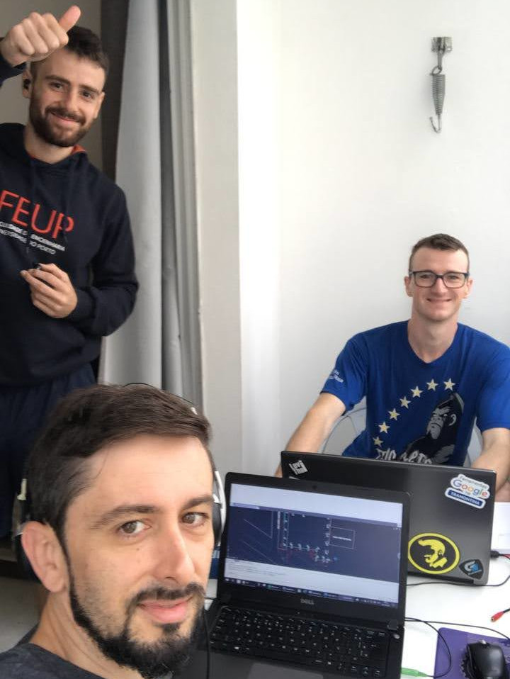

# William Pilger | Authenty

### Fala, tchê! 👋

Sou William, desenvolvedor de softwares, e Sócio-Administrador na Authenty Ltda. Trabalho criando ferramentas que ajudam engenheiros/arquitetos e empresas a organizarem melhor seus processos, e aumentarem a produtividade em seus projetos.

[Meu site](https://pilger.dev.br)

---

## Destaques aqui no GitHub

| Projeto | Repositório | Aplicação |
|---------|-------------|-----------|
| **Dimensionador Elétrico** | - | [PW Elétrica](https://pilger.dev.br/pw-eletric/) |
| **PostInstall Scripts** | [williampilger](https://github.com/williampilger/williampilger) | - |
| **Code Nautilus** | [code-nautilus](https://github.com/williampilger/code-nautilus) | - |
| **Pomodoro Timer** | [PomodoroTimer-Python](https://github.com/williampilger/PomodoroTimer-Python) | - |
| **LazyVim Config** | [nvim](https://github.com/williampilger/nvim) | - |
| **Authenty Piso** | 🔒 Privado | [app.authenty.com.br/PisoDeConcreto](https://app.authenty.com.br/PisoDeConcreto) |
| **Authenty Precificação** | 🔒 Privado | [precificacao.authenty.com.br](https://precificacao.authenty.com.br) |
| **Authenty Site** | 🔒 Privado | [authenty.com.br](https://authenty.com.br) |

Outros repositórios incluem ferramentas para produtividade, automação, utilitários gerais e experimentos em diferentes linguagens e tecnologias.

---

## Estatísticas GitHub

  

---

## Onde me encontrar

&nbsp;&nbsp;&nbsp;

## Authenty Team

O tal do começo 🤩 - 04/10/2021

 
Orgulho de fazer parte do time que busca facilitar e melhorar a engenharia com tecnologia e educação.
